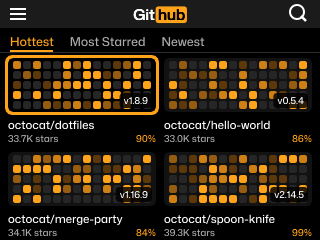

# Hub Badge

Hub Badge shows your name under a bold black-and-orange GitHub logo theme.

## Usage

Open **Hub Badge** from the badge menu. The badge screen shows a large
"Git" + orange "hub" logo, your name, your GitHub handle and a row of
category pills.

- **SELECT** switches between the badge screen and a site-style browse screen.
- On the browse screen, **LEFT**/**RIGHT** change tabs, **UP**/**DOWN** move
  the highlighted card, and **BACK** returns to the badge screen.
- **HOME** returns to the menu.

The browse cards use orange contribution-graph tiles instead of photos. Their
repository names, stars, scores and versions are demo data, not live GitHub data.

## Preview

## Requirements

No Wi-Fi is needed. Set `CONTACT_NAME` and `GITHUB_USERNAME` with the Settings
app (or in `secrets.py` on the badge) to show your own name and handle.
The app loads the badge's system Mona Sans font directly and does not require
the newer firmware's `missing_details` helper.

If the badge's `secrets.py` has invalid Python syntax, the theme still opens
with a "Settings file needs fixing" warning and placeholder profile text.
Correct the settings file on the badge and reopen the app to restore your
profile. The app does not edit your settings or log their contents.

## Credits

Created by **kawaigram**, with GitHub Copilot.
