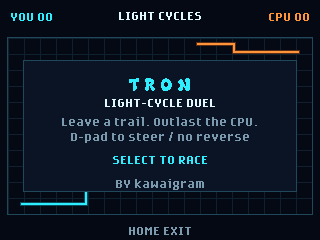

# Tron

Tron is a neon light-cycle duel where you trap an AI rival while avoiding walls and the trails both riders leave behind.



## Playing

Open **tron** from the badge menu and press **Select** to race. You are cyan;
the CPU is orange. After a three-count, both cycles move continuously and
leave permanent, solid trails. Use the **D-pad** to turn at right angles.
You cannot reverse; the first valid turn is queued for the next grid step.
You can queue your opening turn during the countdown.

Avoid the arena walls, your own trail, and the CPU's trail. Trap the CPU to
win the round. Head-on collisions and simultaneous crashes are draws.
The pace gradually increases during a round.

Press **Menu** or **Back** to pause, then **Select** or **Menu** to resume.
From pause or the result screen, **Back** returns to the title. Press
**Select** after a result to race again. **Home** returns to the badge menu.
The scoreboard tracks round wins until you leave the app; draws score no points.

## Requirements

GitHub Universe 2026 badge firmware. No network, secrets, extra hardware, or
saved files are required. Controls use the firmware's orientation-aware
logical buttons. The app renders at 320x240 using built-in fonts and an
original 24x24 menu icon.

## Credits

Created by kawaigram with GitHub Copilot.

## Validation

From the repository root:

```powershell
python -m unittest discover -s tests -p test_tron.py
python .github\skills\hyb26-skill\scripts\validate_app.py badge\apps\tron --target emulator
python .github\scripts\validate_app_readmes.py badge\apps
```

On a physical badge, check start/countdown, all four turns, wall and trail
crashes, round results, pause/resume, replay, and Home/reopen in both
orientations. Confirm the menu displays the custom icon after installation.
